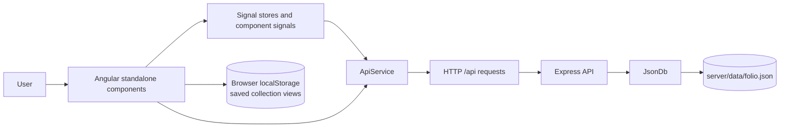
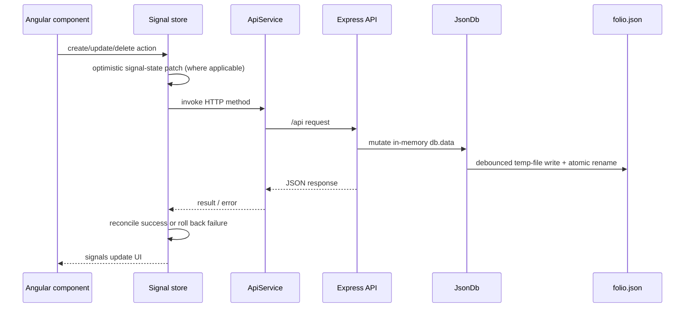

# Folio — Application Architecture

Folio is a local-first document studio. A user creates collections, defines the
fields that belong in each collection, and files documents against those
schemas. The Angular app provides the workspace and editing experience; a
small Express API owns the durable data and stores it in a JSON file on the
machine running the server.

## At a glance



The browser does not write collection or document records directly to
`localStorage`. Those records go through the API and are persisted by the
server. Browser storage is used only for each collection's sort, starred filter,
and selected tag.

## Technology and application shell

- **Angular 21** with standalone components, signal-based inputs/outputs, and
  `OnPush` change detection.
- **Zoneless change detection** is configured in
  [`src/app/app.config.ts`](./src/app/app.config.ts).
- **Angular Signals and NgRx SignalStore** hold shared collection and document
  state. Entity helpers provide normalized collections keyed by ID.
- **Angular Reactive Forms** power the collection editor, schema builder, and
  schema-generated document forms.
- **RxJS** is used for HTTP streams, debouncing, polling, and cancellable
  loading/search pipelines.
- **Express** exposes the local JSON API. `JsonDb` reads and writes the one-file
  store.
- **Tailwind CSS 4** supplies utility styles and custom design tokens; global
  backgrounds, keyframes, and base rules live in `src/styles.scss`.

The root [`App`](./src/app/app.ts) composes the persistent application shell:
the [`AppHeader`](./src/app/shared/app-header/app-header.ts), router outlet,
and toast host. The header includes global search and API health status.
Workspace-specific content is rendered by `WorkspacePage`.

Routes are declared in [`src/app/app.routes.ts`](./src/app/app.routes.ts):

| Route | Behavior |
| --- | --- |
| `/` | Redirects to `/collections`. |
| `/collections` | Loads the workspace and selects the first collection when one exists. |
| `/collections/:id` | Shows the collection identified by the route parameter. |
| Any unmatched path | Redirects to `/collections`. |

`withComponentInputBinding()` maps route parameters and query parameters to
`WorkspacePage` inputs. In particular, `:id` chooses the collection and
`?open=<document-id>` is used to open a document from global search.

## Main user experience

### Collections and workspace navigation

The workspace has a collection rail on larger screens and a horizontal
collection strip on smaller screens. A collection has a name, description,
icon, color, timestamps, and an ordered schema. The server supplies a computed
document count with each collection response.

Selecting a collection navigates to `/collections/:id`. The workspace then
loads its documents using that collection's saved sort/filter/tag preferences.
New collections start on the Schema Studio tab; collections with fields start
on Documents. Users can create, edit, or delete collections, and can reset the
demo dataset. Deleting a collection also deletes its documents, but the
resulting toast offers an undo action.

Primary files:

- [`workspace-page.ts`](./src/app/features/workspace/workspace-page/workspace-page.ts)
  coordinates routing, tab selection, dialogs, drawers, and initial loads.
- [`workspace-page.html`](./src/app/features/workspace/workspace-page/workspace-page.html)
  lays out the page and chooses between empty, loading, error, and active
  collection states.
- [`collections-rail.ts`](./src/app/features/workspace/collections-rail/collections-rail.ts)
  and its template render collection navigation and reset controls.
- [`collection-dialog.ts`](./src/app/features/workspace/collection-dialog/collection-dialog.ts)
  handles creating and editing a collection.

### Schema Studio and generated forms

Each schema field has an ID, a storage key, a label, a type, and a required
flag. Select fields can define options; number fields can define minimum and
maximum values; supported fields can have placeholders. Available field types
are `text`, `textarea`, `number`, `date`, `select`, `tags`, `toggle`, and
`email`.

Schema Studio lets users add, remove, reorder, and configure fields. It
validates required labels, key format and uniqueness, and select options. A
live preview rebuilds as the schema is edited, preserving preview values by
field key. Preview values are temporary and are not saved. Saving persists the
schema through the collection store. Reverting reloads the last saved schema.

The shared form builder keeps schema-driven validation and default values in
one place:

1. [`buildValuesGroup`](./src/app/core/dynamic-form.ts) turns field
   definitions into Angular form controls, adding required, email, and numeric
   min/max validators as appropriate.
2. [`DynamicForm`](./src/app/shared/dynamic-form/dynamic-form.ts) lays out
   fields and resolves controls by key.
3. [`FieldInput`](./src/app/shared/field-input/field-input.ts) renders the
   correct control for a field type and handles shared error display and
   special interactions such as tag entry and toggles.

Removing a field from a schema does not itself issue a migration of stored
documents. The field definition controls which values are shown in generated
forms and card previews.

### Documents

The Documents tab provides:

- A card grid with title, update time, a preview of up to two schema fields,
  tags, and star status.
- Per-collection text filtering, sorting (recently updated, oldest updated,
  title A–Z, recently filed), a starred filter, and tag chips.
- Single-card selection and bulk deletion.
- Create, edit, duplicate, star/unstar, and delete actions.
- An editor drawer with a title, tags, starred flag, and the fields generated
  from the collection's current schema.

The editor validates the title and schema fields before saving. `Enter` does
not submit the form by itself; `Ctrl+Enter` or `⌘+Enter` saves. Closing with
unsaved changes asks for confirmation. The drawer locks background scrolling
while open and focuses the title field after rendering.

[`DocumentCard`](./src/app/features/workspace/document-card/document-card.ts)
is intentionally presentational: it receives a document and collection
metadata, then emits events such as `open`, `star`, `duplicate`, `remove`, and
`select`. The parent panel connects those events to stores or opens the editor.

### Global search

The header's [`Typeahead`](./src/app/shared/typeahead/typeahead.ts) searches
across all collections. It debounces input by 150 ms, supports up/down
navigation, Enter to open a result, Escape to close, and clicking outside to
dismiss. Pressing `/` focuses the search input unless the user is already
typing in an input, textarea, select, or editable element.

The search API searches titles, tags, and document values. With an empty query,
it returns a short list of recently updated documents. Selecting a result
navigates to its collection with `?open=<id>`. The workspace opens the drawer
(loading the document separately if it is not already in the current document
store), then removes the temporary query parameter from the URL.

### Health and notifications

[`HealthService`](./src/app/core/health.service.ts) calls `/api/health`
immediately, every 15 seconds, and whenever `ping()` is called. It exposes the
latest response as a signal and maps it to `checking`, `online`, or `offline`.
The header shows the status and document count; the workspace displays an
offline warning with a retry action.

[`ToastService`](./src/app/core/toast.service.ts) owns the global toast signal.
Toasts have a kind, message, expiration time, and optional action. It limits the
visible list to four, uses longer durations for errors and actionable toasts,
and supports undo actions used by deletes.

## Data model

Shared client-side contracts are in
[`src/app/core/models.ts`](./src/app/core/models.ts). The main relationships
are:

```text
Collection 1 ─────── * DocRecord
     │                      │
     └── schema: FieldDef[] │
                            ├── values: Record<string, unknown>
                            ├── tags: string[]
                            └── starred: boolean
```

- A **Collection** owns metadata and the field schema used to render its
  document forms.
- A **FieldDef** describes one dynamic field; its `key` names the corresponding
  entry in a document's `values`.
- A **DocRecord** belongs to a collection and stores its title, arbitrary
  schema-keyed values, tags, starred state, and timestamps.
- A **SearchHit** packages a document with collection metadata and a matching
  snippet for the typeahead UI.

## State ownership and updates

### CollectionsStore

[`CollectionsStore`](./src/app/state/collections.store.ts) is root-provided and
holds normalized collection entities plus `loaded`, `loading`, and `error`
state. It computes the total document count from collection counts and
provides methods to load, create, update, remove, adjust counts, and reset the
demo data.

Collection updates are optimistic: an edit is applied to the signal store
before the request finishes and rolled back if the API call fails. Removal is
also optimistic. The delete response contains a snapshot of the collection and
its documents; the toast's Undo action posts that snapshot back to the API and
restores the collection in the store.

The store is instrumented with `withDevtools` and glitch tracking from
`@ngrx-toolkit/core`.

### DocumentsStore

[`DocumentsStore`](./src/app/state/documents.store.ts) holds normalized
documents for the active collection, along with the active collection ID,
loading/error state, query, sort, starred filter, selected tag, and selected
document IDs. It computes the visible document count, selection state, and
most-used tags.

Loads are coalesced and deduplicated. A new collection load resets selection
and initializes view state; subsequent loads use the current filters. `switchMap`
means an obsolete in-flight load is unsubscribed when a newer load supersedes
it. The debounced query setter updates state; the workspace reacts to that
state and asks the store to load the filtered documents.

Document mutations use optimistic updates where useful:

| Operation | Local behavior | Failure / undo behavior |
| --- | --- | --- |
| Create | Adds a temporary document and increments the collection count; swaps in the saved document on success. | Removes the temporary record and reverses the count. |
| Update | Applies changes and a new update timestamp immediately. | Restores the previous record if the request fails. |
| Star/unstar | Flips the star immediately. | Restores the prior value if the request fails. |
| Delete | Removes the record, clears its selection, and decrements the count. | Restores it on failure; on success, toast Undo calls the restore API. |
| Bulk delete | Removes selected records and adjusts the count once. | Restores the snapshot on failure; on success, toast Undo restores the documents. |
| Duplicate | Creates a new unstarred document with copied values and tags and a “(copy)” title. | Uses the same create/rollback path. |

### Component-local state and persisted preferences

Tabs, open editor/dialog state, temporary form contents, search query/results,
and selection details are held in component signals or Angular form controls.
They are not global persisted application records.

`loadViewPrefs()` and `saveViewPrefs()` in `models.ts` use a key of
`folio.view.<collectionId>` in browser `localStorage` to remember each
collection's sort, starred filter, and tag. Invalid or unavailable storage falls
back to the default view (`updated_desc`, all documents, no tag). The
free-text collection filter is not part of those saved preferences.

## Request and persistence flow



`ApiService` centralizes the `/api` base URL and typed HTTP calls. It returns
Observables for streaming reads such as lists, and uses `firstValueFrom` for
one-shot operations consumed with `async`/`await`.

The Express implementation is in [`server/index.mjs`](./server/index.mjs).
It validates and normalizes key inputs, returns JSON errors for invalid or
missing resources, and supports:

| Endpoint | Purpose |
| --- | --- |
| `GET /api/health` | API status, counts, uptime, and storage path. |
| `POST /api/reset` | Replace all data with the seed dataset. |
| `GET /api/collections` | List collections with computed document counts. |
| `POST /api/collections` | Create a collection. |
| `PATCH /api/collections/:id` | Update collection metadata or schema. |
| `DELETE /api/collections/:id` | Delete a collection and its documents; return a restorable snapshot. |
| `POST /api/collections/restore` | Restore a deleted collection snapshot. |
| `GET /api/collections/:id/documents` | List a collection's documents with search/filter/sort query parameters. |
| `POST /api/collections/:id/documents` | Create a document in a collection. |
| `GET /api/documents/:id` | Fetch one document, used by global search navigation. |
| `PATCH /api/documents/:id` | Update a document. |
| `DELETE /api/documents/:id` | Delete and return one document for undo. |
| `POST /api/documents/bulk-delete` | Delete and return selected documents. |
| `POST /api/documents/restore` | Restore deleted documents. |
| `GET /api/search` | Global search, or recent documents for an empty query. |

[`JsonDb`](./server/db.mjs) loads `server/data/folio.json` on startup. If the
file does not exist, it initializes it from [`seed()`](./server/seed.mjs); if
the file cannot be parsed, it warns and reseeds. Writes are debounced by 120
ms, serialized to a temporary file, and renamed into place to avoid truncating
the current database file during a write. Shutdown signals flush pending data
synchronously.

This is a single-process local JSON store, not a multi-user database. Data is
owned by the API process and stored on its filesystem; running multiple API
instances against the same file is not a supported concurrency model.

## Development and production

The npm scripts in [`package.json`](./package.json) provide the common flows:

```sh
npm install
npm run start       # Express API on port 3000 + Angular dev server
npm run api          # Express API only
npm run build        # optimized Angular build into dist/folio/browser
npm run serve:dist   # build, then serve the built app and API from Express
npm test             # Angular CLI test runner
```

During development, Angular's dev server proxies `/api` to
`http://localhost:3000` using [`proxy.conf.json`](./proxy.conf.json). The API
also enables permissive CORS for direct local development. When a production
build exists, the Express server serves static files from `dist/folio/browser`
and falls back to `index.html` for client-side routes.

## Source map

```text
src/app/
  app.ts, app.html                 Application shell
  app.routes.ts                    Client-side routes
  core/
    api.service.ts                 HTTP boundary
    models.ts                      Shared data contracts and saved-view helpers
    dynamic-form.ts                Runtime form controls and validators
    format.ts                      Formatting, IDs, search highlighting helpers
    health.service.ts              API polling and online/offline state
    toast.service.ts               Global transient notifications and actions
  state/
    collections.store.ts           Collection entities and mutations
    documents.store.ts             Current document view and mutations
  features/workspace/
    workspace-page/                Route-level coordinator and shell
    collections-rail/              Collection navigation
    documents-panel/               Document view controls and bulk actions
    document-card/                 Presentational document card
    editor-drawer/                 Create/edit document form
    collection-dialog/             Create/edit/delete collection dialog
    schema-studio/                 Schema builder and live preview
  shared/
    app-header/                    Brand, global search, API status
    typeahead/                     Global search interaction
    dynamic-form/                  Schema-driven form layout
    field-input/                   Input control by schema field type
    toasts/                        Global toast presentation
    icon/                          Icon component

server/
  index.mjs                        Express API, validation, search, static serving
  db.mjs                           JSON file load and atomic persistence
  seed.mjs                         Demo collections and documents
  data/folio.json                  Runtime data file (created on first run)
```
