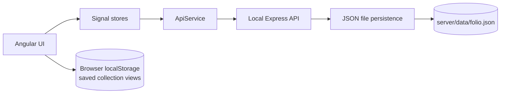

# Folio

Folio is a local-first document studio. Create collections, define the fields
each collection needs, then file, search, filter, sort, star, duplicate, and
delete documents using a responsive card-based workspace.

Collections are flexible: a schema can include text, long text, number, date,
select, tags, toggle, and email fields. The schema drives both the document
editor and the live preview in Schema Studio.

## Tech stack

- **Angular 21** with standalone components, signals, `OnPush`, and zoneless
  change detection
- **NgRx SignalStore** for shared collection and document state, with entity
  helpers and devtools
- **Angular Reactive Forms** for collection, schema, and generated document
  forms
- **RxJS** for HTTP streams, debouncing, polling, and cancellable loads
- **Express 5** for the local JSON API
- **Tailwind CSS 4** for utility styling and the custom visual theme
- **TypeScript 5.9**, **Vitest 4**, and **Node.js** for development and tests

## How it works



The Angular app communicates with the API through `ApiService`. The
`CollectionsStore` and `DocumentsStore` own shared client state and apply
optimistic updates for common mutations, rolling them back if a request fails.
The Express API validates requests and persists collection and document data
to `server/data/folio.json`. Browser `localStorage` is used separately for
per-collection sort, starred-filter, and tag preferences—not for document data.

The global header provides cross-collection search and API status. Search
results navigate to the correct collection and can open a document directly.
The workspace provides collection navigation, document cards, bulk actions,
an editor drawer, and Schema Studio. Delete actions offer undo through toasts.

For the detailed component map, data model, state ownership, API routes, and
request flows, see [ARCHITECTURE.md](./ARCHITECTURE.md).

## Run locally

Install dependencies, then start both the API and Angular development server:

```bash
npm install
npm run start
```

Open [http://localhost:4200](http://localhost:4200). The Angular dev server
proxies `/api` requests to the local API at `http://localhost:3000`.

To run only the API alongside another frontend process:

```bash
npm run api
```

## Useful commands

| Command | Description |
| --- | --- |
| `npm run start` | Start the API and Angular development server together. |
| `npm run api` | Start only the Express API. |
| `npm run build` | Create the optimized Angular build in `dist/folio/browser`. |
| `npm run watch` | Build continuously in development mode. |
| `npm test` | Run the Angular test suite. |
| `npm run serve:dist` | Build the frontend, then serve it and the API from Express. |

The API creates `server/data/folio.json` on first run and seeds it with sample
collections and documents. The JSON file belongs to the machine running the
API; this single-process local store is not intended for concurrent
multi-instance use.
